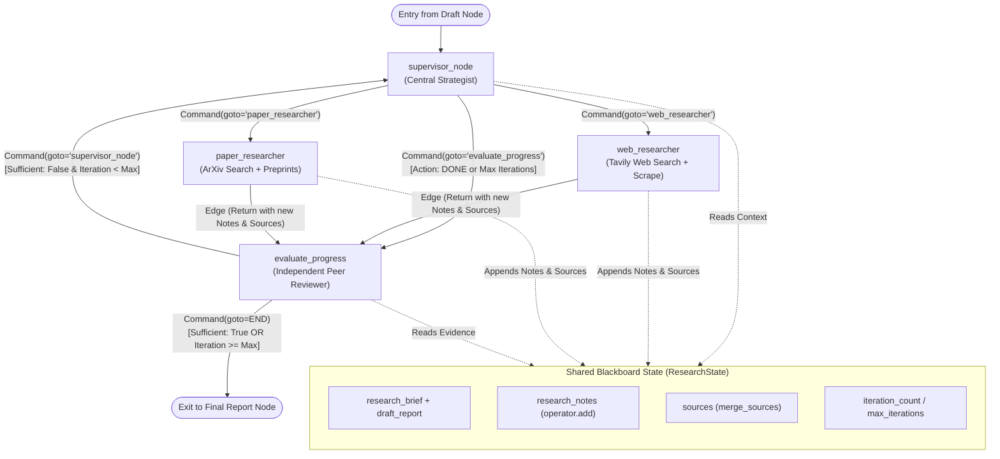
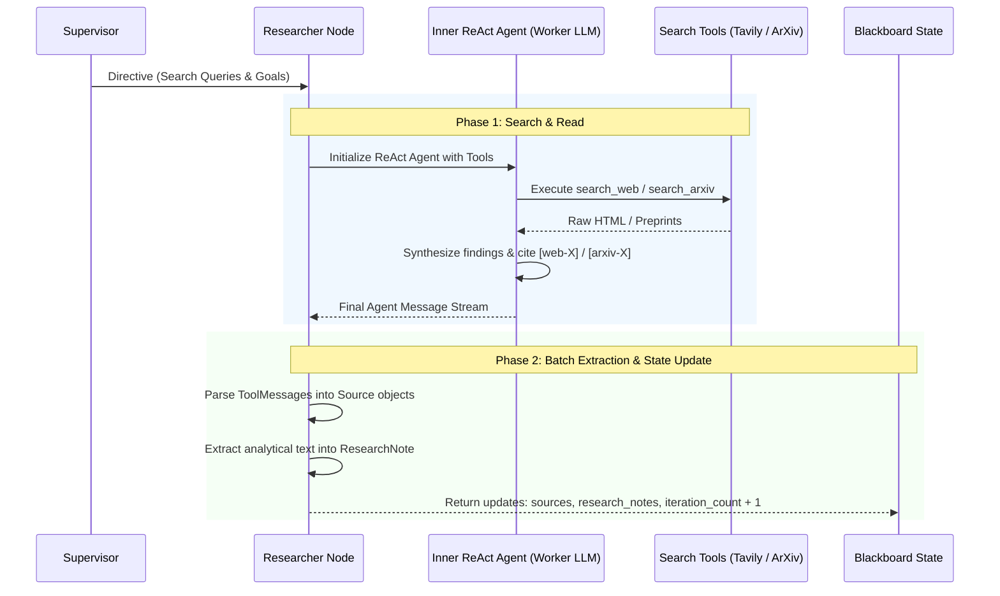

# In-Depth Technical Guide: The Supervisor Research Loop Subgraph

## 1. Executive Overview

The **`supervisor_subgraph`** is the core iterative engine of Deep Researcher. Rather than executing a naive, single-shot search or hardcoding a linear sequence of queries, this subgraph implements an **autonomous, self-governing multi-agent research loop**.

```
supervisor_subgraph       ◄──┐ (Iterative research loop: coordinates platform agents,
   ├─ supervisor_node           │  evaluates evidence coverage, updates blackboard)
   ├─ web_researcher            │
   ├─ paper_researcher          │
   └─ evaluate_progress ────────┘
```

### The Problem It Solves
1. **Context Window Saturation**: If an agent conducts multiple searches in a single prompt context, tokens explode rapidly.
2. **Tunnel Vision & Imbalance**: Pure web search misses academic rigor (theorems, empirical benchmarks), while pure paper search misses breaking industry updates.
3. **Premature or Infinite Looping**: Fixed iteration loops either stop too early with thin evidence or waste compute when sufficient evidence already exists.

### Architectural Solution
The research loop uses a **Two-Tier Agent Architecture** coordinated over a shared **Blackboard State**:
- **Tier 1 (Macro-Planning)**: `supervisor_node` and `evaluate_progress` make strategic decisions (which domain to explore next, whether evidence is complete).
- **Tier 2 (Micro-Execution)**: `web_researcher` and `paper_researcher` run isolated, tool-enabled ReAct sub-agents with dedicated search and scraping capabilities.

---

## 2. Subgraph Architecture & Data Flow



---

## 3. The Four Core Nodes Explained

### Node 1: `supervisor_node` (The Strategist & Dispatcher)
- **File**: `deep_researcher/nodes/supervisor.py`
- **Role**: Analyzes the accumulated evidence against the research plan and decides the next highest-leverage investigation.

#### How It Works:
1. **Context Distillation**: To prevent prompt bloat across iterations, it compresses the blackboard state:
   - Takes the structured `research_brief` summary.
   - Takes the `draft_report` skeleton outline.
   - Takes the **last 15 research notes** (truncated to 250 characters per note).
   - Injects current iteration count vs. maximum allowed.
2. **Structured Reasoning**:
   It invokes the supervisor model (`invoke_structured`) requesting a `SupervisorDecision`:
   ```python
   class SupervisorDecision(BaseModel):
       reasoning: str
       action: Literal["web_research", "paper_research", "DONE"]
       target_questions: list[str]
       search_queries: list[str]
   ```
3. **Dynamic Routing via LangGraph `Command`**:
   Instead of using standard conditional edges, it returns a LangGraph `Command` that **atomically updates state and selects the next node**:
   - If `action == "DONE"`:
     ```python
     return Command(goto="evaluate_progress", update={"current_phase": "evaluation"})
     ```
   - If `action == "web_research"` or `"paper_research"`:
     Formulates a directive string containing specific search queries and targets, writes it to `messages`, and directs flow directly to that worker:
     ```python
     return Command(
         goto="web_researcher" if decision.action == "web_research" else "paper_researcher",
         update={"messages": [HumanMessage(content=directive)], "current_phase": "research"}
     )
     ```
4. **Heuristic Fallback**:
   If LLM structured parsing fails, it safely falls back to alternating between web and paper research rather than crashing the pipeline.

---

### Node 2 & 3: `web_researcher` & `paper_researcher` (The Domain Specialists)
- **File**: `deep_researcher/nodes/researchers.py`
- **Role**: Execute targeted investigations in their specific information domains.

Both researchers follow a strict **Two-Phase Protocol**:



#### Detailed Breakdown of Worker Mechanics:
1. **Isolated Inner ReAct Agent**:
   Each worker dynamically instantiates a lightweight, deterministic agent using `create_react_agent(model=get_worker_llm(), tools=...)`:
   - `web_researcher`: Equipped with `search_web` (Tavily search) and `extract_webpage_content` (full-text page scraping).
   - `paper_researcher`: Equipped with `search_arxiv` (queries metadata, abstracts, categories, and authors).
2. **Circuit Breaker Protection**:
   All tool invocations are wrapped inside circuit breakers (`web_circuit_breaker`, `arxiv_circuit_breaker`). If Tavily or ArXiv APIs experience rate limits, HTTP 500s, or connection timeouts, the circuit trips to `OPEN`, preventing cascading hangs and recording a graceful failure note.
3. **Structured Source Parsing**:
   The worker inspects all `ToolMessage` instances generated during the ReAct session:
   - For web: Extracts URLs, titles, scores, and text snippets into `Source(local_id="web-1", ...)`.
   - For arXiv: Extracts arXiv IDs, published dates, author lists, and abstracts into `Source(local_id="arxiv-1", ...)`.
4. **Synthesis & Note Generation**:
   The final `AIMessage` produced by the ReAct agent is packaged into a `ResearchNote` tagged with all discovered `source_ids`.
5. **State Return**:
   The worker returns:
   ```python
   return {
       "sources": extracted_sources,
       "research_notes": [note],
       "iteration_count": state.get("iteration_count", 0) + 1,
       "current_phase": "evaluation",
   }
   ```
   Both workers have static edges routing straight into `evaluate_progress`.

---

### Node 4: `evaluate_progress` (The Quality Assessor & Loop Gate)
- **File**: `deep_researcher/nodes/evaluate.py`
- **Role**: Acts as an independent peer reviewer to determine if research is comprehensive enough to author the monograph, or if the loop must continue.

#### How It Works:
1. **Hard Threshold Check**:
   If `iteration_count >= max_iterations` (default: 5), it halts the loop immediately:
   ```python
   return Command(goto=END, update={"current_phase": "final"})
   ```
2. **Empirical Evidence Inspection**:
   It compiles the latest 10 research notes and total source counts, submitting them to the evaluator LLM with strict evaluation criteria:
   - `coverage_score`: 1 to 10 scale across all questions in the brief.
   - `gaps`: Identifies unanswered technical questions.
   - `sufficient`: Boolean flag indicating whether evidence is authoritative and cited.
   - `next_priority`: Guidance on what is most urgently missing.
3. **Dynamic Routing via `Command`**:
   - If `eval_result.sufficient is True`:
     Routes to `END` (exiting the loop and passing control to `final_report_node`).
   - If `eval_result.sufficient is False`:
     Routes back to `supervisor_node` to trigger the next research cycle.
4. **Safety Heuristic**:
   If structured output fails and at least 3 high-quality notes and sources exist, it treats the evidence as sufficient to prevent unnecessary token consumption and infinite loops.

---

## 4. The Blackboard State & Custom Reducers

All nodes interact via a single shared data structure called the **Blackboard State** (`ResearchState`).

```python
class ResearchState(TypedDict):
    messages: Annotated[list[BaseMessage], add_messages]
    topic: str
    research_brief: ResearchBrief | None
    draft_report: DraftReport | None
    detected_language: str

    # Accumulated Research (Managed by Reducers)
    research_notes: Annotated[list[ResearchNote], operator.add]
    sources: Annotated[list[Source], merge_sources]
    iteration_count: int
    max_iterations: int
    current_phase: str

    final_report: str
    sources_json: str
```

### Why Reducers Matter:
In LangGraph, when a node returns a dictionary, the state values are overwritten by default. **Reducers** define custom merge behaviors:

1. **`operator.add` on `research_notes`**:
   - Ensures notes are **never lost or overwritten**.
   - When a worker returns `{"research_notes": [new_note]}`, LangGraph automatically appends it:
     $$\text{state.research\_notes} \leftarrow \text{state.research\_notes} + [\text{new\_note}]$$

2. **`merge_sources` on `sources`**:
   - Prevents duplicate URLs or duplicate arXiv papers.
   - Uses a deduplication key: `(url or arxiv_id or local_id).lower()`.
   - **Enrichment on collision**: If a newly retrieved source matches an existing source, the reducer updates the existing record with richer metadata (e.g. longer titles, author lists, or full snippets) without creating duplicate bibliography entries.

3. **`add_messages` on `messages`**:
   - Maintains the LangChain message history cleanly using standard message IDs.

---

## 5. Summary of Key Architectural Strengths

| Pattern | Implementation | Benefit |
|:---|:---|:---|
| **Blackboard Pattern** | Central `ResearchState` with custom reducers | Independent agents coordinate asynchronously without direct coupling. |
| **Command-based Routing** | `Command(goto=..., update=...)` | Eliminates complex conditional edge spaghetti; state update and next node selection are atomic. |
| **Two-Tier Agent Hierarchy** | Supervisor (Planner) + ReAct Workers (Executors) | Separates high-level research strategy from low-level tool execution and HTML scraping. |
| **Dual-Domain Coverage** | Web (Tavily) + Academic (ArXiv) | Delivers balanced synthesis containing both theoretical rigor (papers) and practical benchmarks (industry). |
| **Context Distillation** | Rolling note windows (-15 notes, -10 notes) | Prevents context window saturation across extended research loops. |
| **Fault Tolerance** | Circuit breakers + Structured Regex Recovery + Heuristics | Guaranteed progress even if local models hallucinate, APIs time out, or rate limits occur. |
